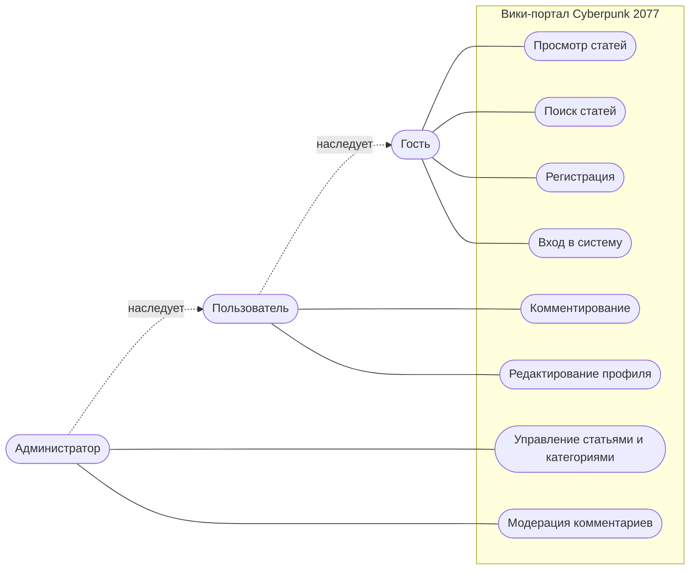

# 4. Функциональные требования и диаграмма прецедентов

## Роли

- **Гость** — не вошёл в систему.
- **Пользователь** — зарегистрирован и вошёл.
- **Администратор** — управляет содержимым сайта.

## Функциональные требования

**Гость:**
1. Просматривать главную страницу, список статей категории и сами статьи.
2. Искать статьи по ключевым словам.
3. Читать комментарии.
4. Зарегистрироваться и войти в систему.

**Пользователь** (всё, что может гость, и дополнительно):

5. Оставлять комментарии к статьям.
6. Изменять и удалять свои комментарии.
7. Просматривать и редактировать свой профиль.
8. Выходить из системы.

**Администратор** (всё, что может пользователь, и дополнительно):

9. Создавать, редактировать и удалять статьи.
10. Создавать, редактировать и удалять категории.
11. Удалять любые комментарии.

## Диаграмма прецедентов

> Диаграмма сделана в Mermaid, поэтому нотация упрощённая. При необходимости её можно перерисовать в draw.io по тем же данным.
