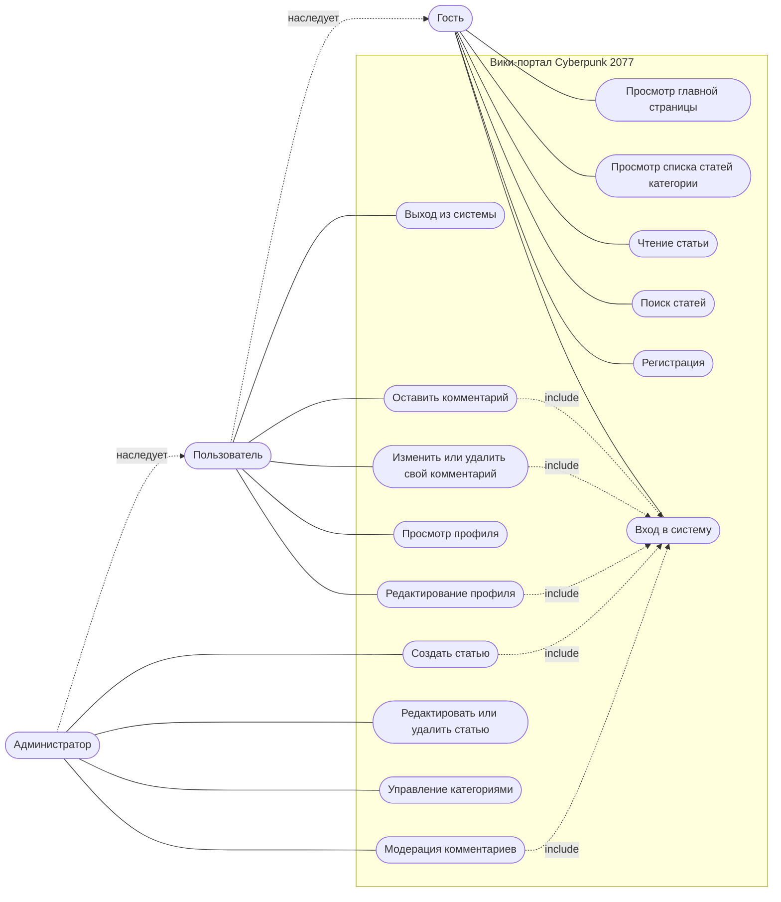

# 4. Функциональные требования и диаграмма вариантов использования

## 4.1. Роли пользователей

| Роль | Описание |
|------|----------|
| Гость | Не авторизован. Читает статьи, пользуется поиском, может зарегистрироваться или войти |
| Пользователь | Авторизован. Имеет все возможности гостя, а также комментирует статьи и ведёт профиль |
| Администратор | Имеет все возможности пользователя, а также управляет статьями, категориями и комментариями |

Права наследуются: **Администратор → Пользователь → Гость**.

## 4.2. Функциональные требования

### Просмотр контента (гость и выше)

| ID | Требование |
|----|-----------|
| FR-01 | Система отображает главную страницу со списком категорий и новыми статьями |
| FR-02 | Система отображает список статей выбранной категории с постраничной навигацией |
| FR-03 | Система позволяет сортировать список статей и отфильтровать только материалы по Phantom Liberty |
| FR-04 | Система отображает страницу статьи: заголовок, обложку, текст, карточку свойств и комментарии |
| FR-05 | Система выполняет поиск статей по ключевым словам в заголовке, описании и тексте |
| FR-06 | Система выводит результаты поиска со счётчиком найденных статей; при отсутствии результатов показывает соответствующее сообщение |

### Учётные записи (гость и пользователь)

| ID | Требование |
|----|-----------|
| FR-07 | Гость может зарегистрироваться, указав имя пользователя, email и пароль |
| FR-08 | Система проверяет уникальность имени и email, а также соответствие пароля требованиям (не менее 8 символов) |
| FR-09 | Гость может войти в систему по email и паролю |
| FR-10 | Пользователь может выйти из системы |
| FR-11 | Пользователь может просматривать свой профиль |
| FR-12 | Пользователь может изменить имя, email, пароль и аватар |
| FR-13 | В профиле отображается список комментариев пользователя |

### Комментарии (пользователь)

| ID | Требование |
|----|-----------|
| FR-14 | Авторизованный пользователь может оставить комментарий под статьёй |
| FR-15 | Пользователь может редактировать и удалять только собственные комментарии |
| FR-16 | Гостю вместо формы комментария предлагается войти в систему |

### Администрирование (администратор)

| ID | Требование |
|----|-----------|
| FR-17 | Администратор может создать статью: название, адрес, категория, признак Phantom Liberty, описание, обложка, текст |
| FR-18 | Администратор может редактировать и удалять любую статью |
| FR-19 | Администратор может создавать, переименовывать и удалять категории (удаление возможно только для пустой категории) |
| FR-20 | Администратор может просматривать все комментарии и удалять любой из них |
| FR-21 | Административные страницы недоступны гостям и обычным пользователям |

## 4.3. Нефункциональные требования

| ID | Требование |
|----|-----------|
| NFR-01 | Пароли хранятся только в виде хэша |
| NFR-02 | Весь пользовательский ввод проверяется на сервере и экранируется при выводе (защита от XSS) |
| NFR-03 | Страницы корректно отображаются на экранах шириной от 360 px (адаптивная вёрстка) |
| NFR-04 | Любая статья достижима с главной страницы не более чем за три перехода |
| NFR-05 | Время ответа сервера на типовой запрос не превышает 1 секунды при нагрузке учебного проекта |
| NFR-06 | Поддерживаются актуальные версии Chrome, Firefox, Edge и Safari |

## 4.4. Диаграмма вариантов использования

> GitHub отображает диаграммы Mermaid автоматически. Mermaid не содержит нативной UML-нотации прецедентов, поэтому диаграмма построена в её стилистике: актёры слева, овалы внутри границы системы — прецеденты, пунктир с подписью `include` — включение. Если преподавателю нужна строгая UML-нотация, диаграмму можно перерисовать в draw.io или StarUML по тем же данным.

## 4.5. Описание вариантов использования

### UC-05. Регистрация

| Поле | Описание |
|------|----------|
| Актёр | Гость |
| Предусловие | Пользователь не авторизован |
| Основной сценарий | 1. Гость открывает страницу регистрации. 2. Вводит имя пользователя, email, пароль и его повтор. 3. Нажимает «Создать аккаунт». 4. Система проверяет данные, создаёт учётную запись и автоматически выполняет вход. 5. Система перенаправляет пользователя на главную страницу |
| Альтернативные сценарии | 4а. Имя или email уже заняты — система показывает ошибку у соответствующего поля. 4б. Пароль слишком короткий или пароли не совпадают — система показывает ошибку |
| Постусловие | Создана учётная запись с ролью «Пользователь» |

### UC-06. Вход в систему

| Поле | Описание |
|------|----------|
| Актёр | Гость |
| Предусловие | Гость зарегистрирован |
| Основной сценарий | 1. Гость открывает страницу входа. 2. Вводит email и пароль. 3. Система проверяет данные и создаёт сессию. 4. Система возвращает пользователя на страницу, с которой он пришёл |
| Альтернативные сценарии | 3а. Неверный email или пароль — система показывает общее сообщение об ошибке, не уточняя, что именно неверно |
| Постусловие | Пользователь авторизован, в шапке сайта отображаются «Профиль» и «Выход» |

### UC-04. Поиск статей

| Поле | Описание |
|------|----------|
| Актёр | Гость, пользователь, администратор |
| Предусловие | Нет |
| Основной сценарий | 1. Пользователь вводит запрос в поле поиска в шапке сайта. 2. Нажимает «Найти». 3. Система отображает страницу результатов: заголовок, категория и фрагмент описания каждой найденной статьи |
| Альтернативные сценарии | 2а. Запрос пустой — поиск не выполняется. 3а. Ничего не найдено — выводится сообщение «По вашему запросу ничего не найдено» |
| Постусловие | Нет |

### UC-08. Оставить комментарий

| Поле | Описание |
|------|----------|
| Актёр | Пользователь |
| Предусловие | Пользователь авторизован и находится на странице статьи |
| Основной сценарий | 1. Пользователь вводит текст в форму комментария. 2. Нажимает «Отправить». 3. Система проверяет текст, сохраняет комментарий и добавляет его в список под статьёй |
| Альтернативные сценарии | 3а. Текст пуст или превышает допустимую длину — выводится сообщение об ошибке. 3б. Сессия истекла — система предлагает войти заново (UC-06) |
| Постусловие | Комментарий сохранён и виден всем посетителям |

### UC-12. Создать статью

| Поле | Описание |
|------|----------|
| Актёр | Администратор |
| Предусловие | Администратор авторизован |
| Основной сценарий | 1. Администратор открывает админ-панель и нажимает «+ Новая статья». 2. Заполняет название, адрес, категорию, признак Phantom Liberty, описание, обложку и текст. 3. Нажимает «Сохранить». 4. Система проверяет данные, сохраняет статью и открывает её страницу |
| Альтернативные сценарии | 4а. Адрес статьи уже занят — система просит указать другой. 4б. Обязательные поля не заполнены — система подсвечивает их |
| Постусловие | Статья опубликована и доступна всем посетителям |

### UC-15. Модерация комментариев

| Поле | Описание |
|------|----------|
| Актёр | Администратор |
| Предусловие | Администратор авторизован |
| Основной сценарий | 1. Администратор открывает вкладку «Комментарии» админ-панели. 2. При необходимости фильтрует список по статье или тексту. 3. Нажимает «Удалить» напротив нарушающего правила комментария. 4. Система удаляет комментарий и обновляет список |
| Постусловие | Комментарий удалён и не отображается на странице статьи |

Остальные прецеденты (просмотр, редактирование профиля, управление категориями и т.д.) имеют простой линейный сценарий и подробно не описываются.
