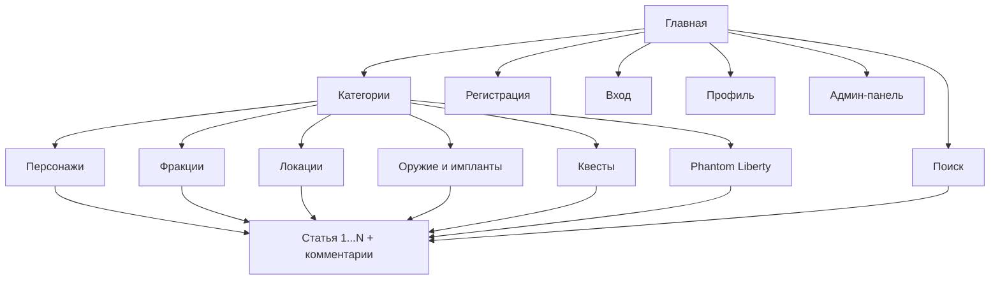

# 5. Информационная структура сайта

## Пояснения

Структура иерархическая: Главная → Категория → Статья. Любая статья открывается не более чем за три перехода.

| Страница | Кто видит |
|----------|-----------|
| Главная, категории, статьи, поиск | все |
| Регистрация, вход | гости |
| Профиль | пользователь и администратор |
| Админ-панель (статьи, категории, комментарии) | только администратор |

Во всех разделах одинаковая шапка (логотип, название, категории, поиск, кнопки входа или профиля) и подвал с контактами.

Раздел «Phantom Liberty» показывает статьи про дополнение из любых категорий.
