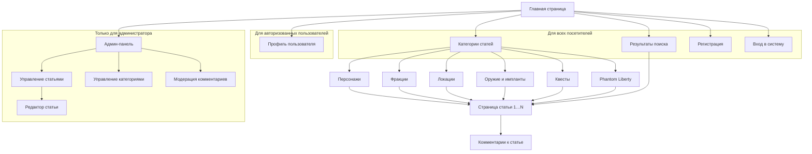

# 5. Информационная структура веб-сайта

## 5.1. Принципы проектирования

Структура строится от задач посетителя, а не от устройства базы данных: человек приходит, чтобы найти сведения об игровом объекте, поэтому разделы названы так, как их называют сами игроки.

1. **Короткий путь к содержимому.** Любая статья доступна с главной страницы не более чем за три перехода: Главная → Категория → Статья.
2. **Знакомые категории.** Разделы повторяют привычное деление игрового мира: персонажи, фракции, локации, снаряжение, квесты.
3. **Поиск всегда под рукой.** Поле поиска находится в шапке каждой страницы, потому что часть посетителей сразу знает, что ищет.
4. **Единая навигация.** Шапка и подвал одинаковы на всех страницах, меняется только правая часть шапки в зависимости от роли.
5. **Разделение по правам.** Служебные разделы не пересекаются с контентными и видны только тем ролям, которым они нужны.

## 5.2. Логическая структура сайта

Раздел «Phantom Liberty» не хранит собственных копий статей: он показывает статьи из любых категорий, помеченные признаком дополнения.

## 5.3. Описание разделов

| Раздел | Адрес | Доступ | Содержимое |
|--------|-------|--------|-----------|
| Главная | `/` | все | Приветствие, плитки шести категорий, блок новых статей |
| Категория | `/category/:slug` | все | Список статей с обложкой и кратким описанием, сортировка, фильтр по Phantom Liberty, постраничная навигация |
| Статья | `/article/:slug` | все | Заголовок, обложка, текст, карточка свойств, комментарии |
| Поиск | `/search?q=` | все | Список найденных статей, счётчик результатов |
| Регистрация | `/register` | гости | Форма создания учётной записи |
| Вход | `/login` | гости | Форма входа |
| Профиль | `/profile` | пользователь, администратор | Данные учётной записи, форма редактирования, список своих комментариев |
| Админ-панель | `/admin` | администратор | Вкладки «Статьи», «Категории», «Комментарии» |
| Редактор статьи | `/admin/articles/new`, `/admin/articles/:id/edit` | администратор | Форма создания и изменения статьи |
| Модерация | `/admin/comments` | администратор | Таблица всех комментариев с удалением |

Вкладка «Категории» админ-панели устроена так же, как «Статьи»: таблица с кнопками «Изменить» и «Удалить» и кнопка добавления.

## 5.4. Навигация

**Шапка (на всех страницах):** логотип со ссылкой на главную, название проекта, выпадающий список категорий, поле поиска. Правая часть зависит от роли:

| Роль | Элементы справа |
|------|-----------------|
| Гость | «Регистрация», «Вход» |
| Пользователь | «Профиль», «Выход» |
| Администратор | «Админ-панель», «Профиль», «Выход» |

**Подвал (на всех страницах):** «Контакты» и пометка о том, что проект неофициальный.

**Хлебные крошки** на страницах категории и статьи показывают путь вида «Главная / Персонажи / Название статьи» и позволяют подняться на уровень выше.

## 5.5. Достоинства и недостатки выбранной иерархической структуры

| Достоинства | Недостатки |
|-------------|-----------|
| Привычна и понятна посетителю | Объект, подходящий сразу к нескольким категориям, приходится относить к одной (например, персонаж дополнения) |
| Предсказуемое число переходов до любой страницы | При росте числа категорий меню становится длинным |
| Просто реализуется и хорошо индексируется поисковиками | Посетитель, не знающий категории, вынужден пользоваться поиском |

Недостаток с принадлежностью к нескольким разделам компенсируется признаком Phantom Liberty, а проблема поиска — полем поиска в шапке каждой страницы.
