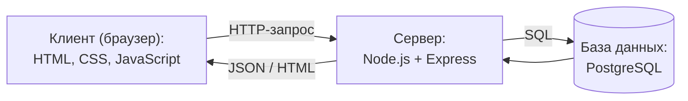

# 6. Программная архитектура

Приложение состоит из трёх частей: браузер (клиент), сервер и база данных.

## Технологии

- **Клиент:** HTML, CSS, JavaScript без фреймворков.
- **Сервер:** Node.js + Express. Обрабатывает запросы, проверяет права доступа (гость, пользователь, администратор).
- **База данных:** PostgreSQL.
- **Вход в систему:** пароли хранятся в виде хэша (bcrypt).

## Что делает сервер

- отдаёт страницы сайта;
- принимает запросы на статьи, поиск, регистрацию, вход, комментарии;
- проверяет, имеет ли пользователь право на действие (например, удалять статьи может только администратор).

## База данных

Четыре таблицы:

- **users** — id, имя, email, хэш пароля, роль (пользователь или администратор)
- **categories** — id, название
- **articles** — id, название, текст, id категории, признак Phantom Liberty
- **comments** — id, id статьи, id пользователя, текст, дата

Связи: в категории много статей, у статьи много комментариев, пользователь пишет много комментариев.
