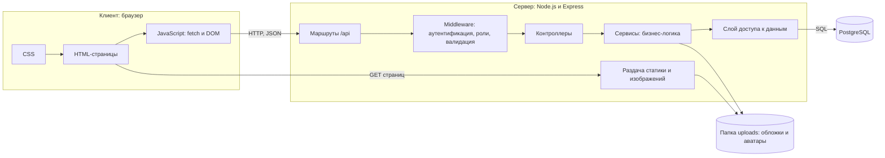
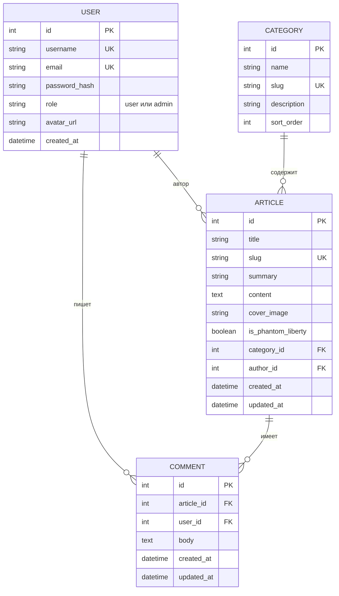
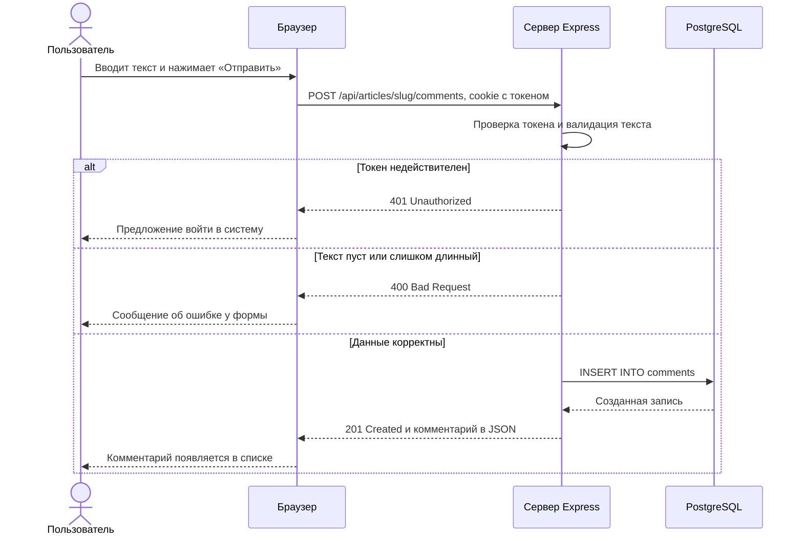

# 6. Программная архитектура веб-приложения

## 6.1. Общая схема

Приложение строится по клиент-серверной трёхзвенной архитектуре:

1. **Клиент** — браузер: HTML-страницы, CSS и JavaScript, который запрашивает данные у сервера через `fetch` и обновляет страницу через DOM.
2. **Сервер приложения** — Node.js + Express: раздаёт страницы, реализует REST API, проверяет права доступа и содержит бизнес-логику.
3. **База данных** — PostgreSQL: хранит пользователей, категории, статьи и комментарии.

Обмен между клиентом и сервером происходит в формате JSON по протоколу HTTP.

## 6.2. Выбор технологий

| Уровень | Технология | Обоснование |
|---------|-----------|-------------|
| Клиент | HTML5, CSS3, JavaScript (ES6+) без фреймворков | Соответствует программе курса; результаты лабораторных работ №2–4 переиспользуются в курсовой |
| Сервер | Node.js + Express | Тот же язык, что на клиенте; простой маршрутизатор и экосистема middleware |
| База данных | PostgreSQL | Данные строго структурированы и связаны (категория → статья → комментарий), нужны внешние ключи и полнотекстовый поиск |
| Доступ к БД | библиотека `pg` (или Knex.js) | Прямая работа с SQL, наглядная для защиты |
| Аутентификация | JWT в cookie с флагом `httpOnly` + `bcrypt` | Сессия не доступна из JavaScript, пароли хранятся в виде хэша |
| Валидация | `express-validator` | Проверка входных данных на сервере |
| Загрузка файлов | `multer` | Обложки статей и аватары |
| Контроль версий | Git, GitHub | Требование курса |

## 6.3. Диаграмма компонентов



## 6.4. Слои серверной части

| Слой | Ответственность | Пример |
|------|----------------|--------|
| Маршруты (`routes`) | Сопоставляют URL и HTTP-метод с контроллером | `POST /api/articles/:slug/comments` |
| Middleware | Проверка JWT, проверка роли, валидация, обработка ошибок | `requireAuth`, `requireAdmin` |
| Контроллеры (`controllers`) | Принимают запрос, вызывают сервис, формируют ответ и код состояния | `commentController.create` |
| Сервисы (`services`) | Бизнес-правила: проверка уникальности, права на правку чужого комментария | `commentService.create` |
| Доступ к данным (`repositories`) | Все SQL-запросы | `commentRepository.insert` |

Такое разделение позволяет менять способ хранения данных, не трогая бизнес-логику, и проверять каждый слой отдельно.

## 6.5. Модель данных



Сущность `USER` хранится в таблице `users`, чтобы не конфликтовать с зарезервированным словом `user` в PostgreSQL.

**Правила целостности:**
- удаление статьи удаляет её комментарии (`ON DELETE CASCADE`);
- удаление категории запрещено, пока в ней есть статьи (`ON DELETE RESTRICT`);
- удаление пользователя удаляет его комментарии;
- поиск выполняется по полям `title`, `summary` и `content` (индекс `tsvector` или оператор `ILIKE`).

## 6.6. REST API

| Метод | Адрес | Доступ | Назначение |
|-------|-------|--------|-----------|
| POST | `/api/auth/register` | гость | Регистрация |
| POST | `/api/auth/login` | гость | Вход, установка cookie с токеном |
| POST | `/api/auth/logout` | пользователь | Выход |
| GET | `/api/auth/me` | пользователь | Данные текущего пользователя |
| GET | `/api/categories` | все | Список категорий |
| POST, PUT, DELETE | `/api/categories`, `/api/categories/:id` | администратор | Управление категориями |
| GET | `/api/articles` | все | Список статей: `?category=`, `?pl=true`, `?sort=`, `?page=` |
| GET | `/api/articles/:slug` | все | Статья целиком |
| POST | `/api/articles` | администратор | Создание статьи |
| PUT, DELETE | `/api/articles/:id` | администратор | Изменение и удаление статьи |
| GET | `/api/search?q=` | все | Поиск статей |
| GET | `/api/articles/:slug/comments` | все | Комментарии к статье |
| POST | `/api/articles/:slug/comments` | пользователь | Добавление комментария |
| PUT | `/api/comments/:id` | автор комментария | Изменение комментария |
| DELETE | `/api/comments/:id` | автор или администратор | Удаление комментария |
| GET, PUT | `/api/profile` | пользователь | Просмотр и изменение профиля |
| GET | `/api/admin/comments` | администратор | Все комментарии для модерации |

Коды ответов: `200` и `201` — успех, `400` — ошибка валидации, `401` — не авторизован, `403` — недостаточно прав, `404` — не найдено, `409` — конфликт уникальности.

## 6.7. Пример взаимодействия: добавление комментария



## 6.8. Безопасность

| Угроза | Мера защиты |
|--------|------------|
| Кража паролей из БД | Хранение хэшей `bcrypt` |
| Кража токена через XSS | Cookie с флагами `httpOnly` и `sameSite`; экранирование пользовательского текста при выводе |
| SQL-инъекции | Параметризованные запросы |
| Доступ к админ-функциям | Проверка роли на сервере в middleware; скрытие кнопок на клиенте служит только удобству |
| Правка чужих комментариев | Сервис сравнивает `user_id` комментария с текущим пользователем |
| Загрузка вредоносных файлов | Ограничение типа (JPEG, PNG, WebP) и размера файла |
| Перебор паролей | Ограничение частоты запросов к `/api/auth/login` |

## 6.9. Планируемая структура проекта

```
course-project/
├── server/
│   ├── app.js
│   ├── routes/
│   ├── controllers/
│   ├── services/
│   ├── repositories/
│   ├── middleware/
│   └── db/              схема и миграции
├── public/
│   ├── pages/           HTML-страницы
│   ├── css/
│   ├── js/
│   └── uploads/         загруженные изображения
├── package.json
└── README.md
```
